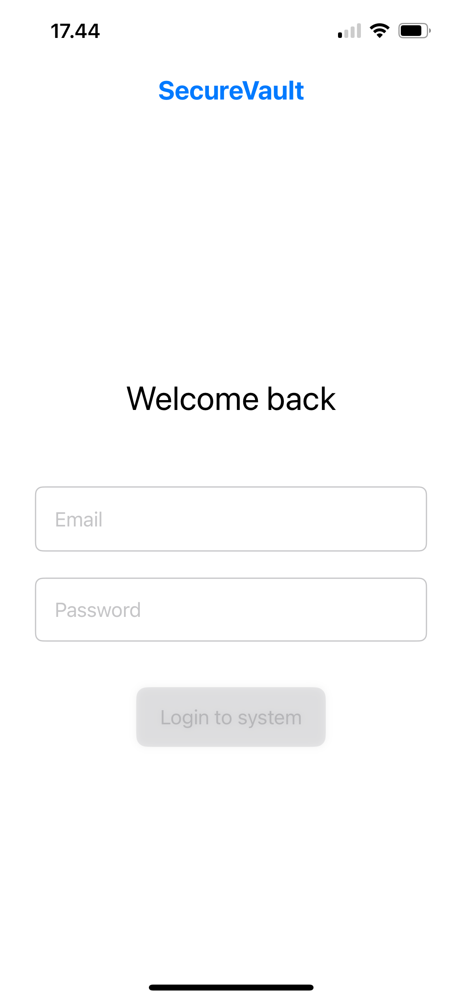
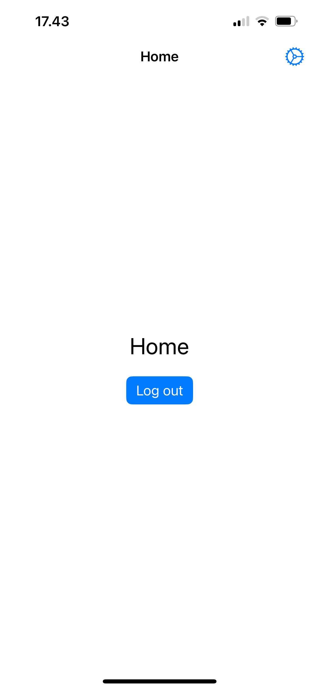
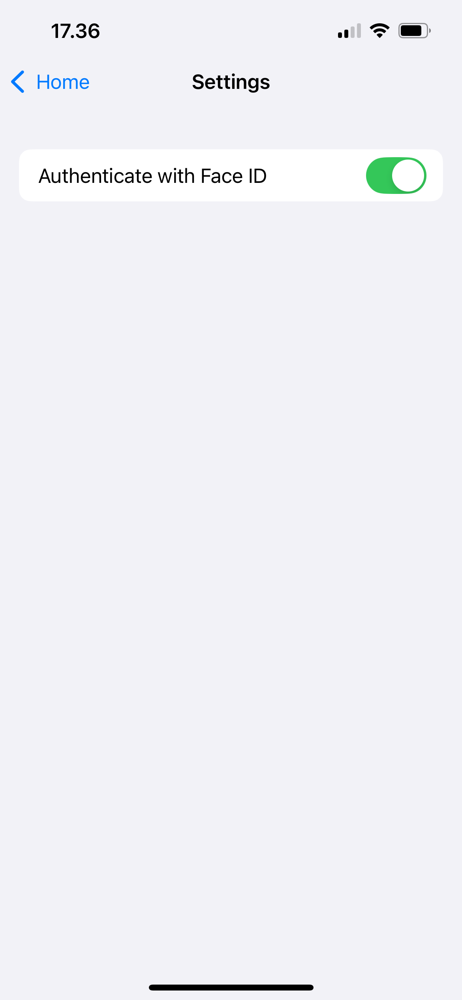
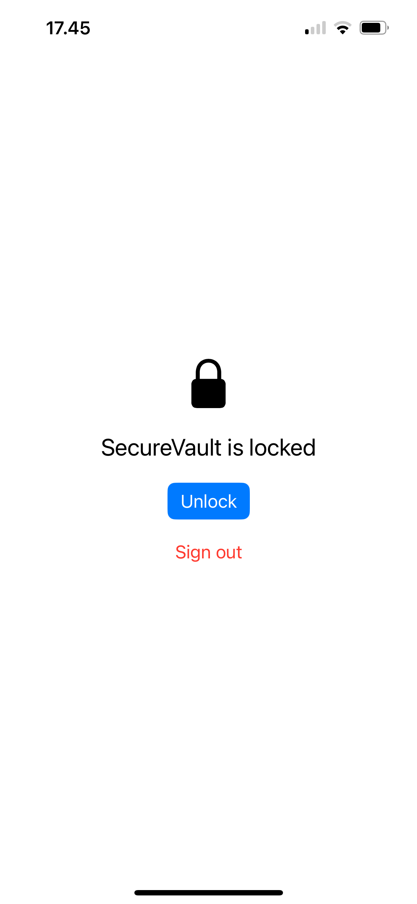

# SecureVault

A SwiftUI iOS app that demonstrates a secure authentication flow: email/password sign-in against a Supabase backend, a persisted session, and an optional Face ID / Touch ID lock that the user turns on from a Settings screen.

I built it as a portfolio project to show how I structure a small, testable iOS app with modern Apple frameworks, and to document the security trade-offs I made along the way.

> **Status:** work in progress. See [Project status](#project-status) for what is done and what is planned.
<!-- <p align="left">
        
</p> -->

| Login | Home | Settings | Locked Mode |
|:---:|:---:|:---:|:---:|
|  |  |  |  |

## What it does

- Sign in with email and password (Supabase Auth)
- Restore the session on launch, so the user doesn't type their password every time
- Log out, including when the network is unavailable
- Optional biometric lock: when enabled in Settings, the app asks for Face ID / Touch ID (with device passcode as fallback) on every cold launch
- Settings screen reached from a gear button on Home, using `NavigationStack`

## Tech stack

| Area | Technology |
|---|---|
| UI | SwiftUI, `NavigationStack` |
| State | Observation framework (`@Observable`), `@MainActor` |
| Concurrency | Swift concurrency (`async`/`await`) |
| Biometrics | LocalAuthentication (`LAContext`) |
| Secure storage | Keychain Services (Security framework) |
| Backend | Supabase Swift SDK 2.55.4 (via Swift Package Manager) |
| Testing | XCTest / Swift Testing with hand-written fakes (planned) |

## Architecture

The app uses a lightweight MVVM structure. Views are thin, one view model owns the app's auth state, and everything that touches the outside world (network, Keychain, Face ID) sits behind a protocol so it can be replaced with a fake.

```
View  →  AuthViewModel  →  protocol (AuthService / DeviceAuthenticator / KeychainStore)
                                   ↑
                       real implementation or fake
```

```
SecureVault/
├── SecureVault/        App entry point (SecureVaultApp) and assets
├── Services/           Protocols and their real implementations
│   ├── AuthService               protocol
│   ├── SupabaseAuthService       wraps SupabaseClient
│   ├── DeviceAuthenticator       protocol (+ system implementation using LocalAuthentication)
│   ├── KeychainStore             protocol
│   ├── SystemKeychainStore       Keychain Services implementation
│   └── BiometricPreference       stores the "lock enabled" setting
├── ViewModel/          AuthViewModel, PasswordPolicy
├── Views/              SignupLoginView, HomeView, SettingsView, LockedView
├── Components/         Reusable UI (BorderedField)
├── Extensions/         String+Validation
└── Preview/            Fakes used by SwiftUI previews (DEBUG only)
```

### App state

`AuthViewModel` is a `@MainActor @Observable` class with a single `state` enum (`loading`, `locked`, `signedOut`, `signedIn`). `RootView` switches on that state, so there is one source of truth for which screen is showing.

### Dependency injection

The view model receives its dependencies through its initializer. In the app these are the real implementations; in previews and unit tests they are in-memory fakes (for example, a fake Keychain backed by a dictionary and a fake authenticator that returns a canned result). No view or view model imports `LocalAuthentication` directly, which is what makes the lock logic testable without a device.

## Design decisions

These are the decisions I'd want a reviewer to know about, and why I made them.

**The session is not stored twice.** The Supabase SDK already persists its session in the Keychain, so the app doesn't keep its own copy.

**The Face ID preference lives in the Keychain, not `UserDefaults`.** Keychain items survive app deletion, while a `UserDefaults` flag doesn't. If the flag were in `UserDefaults`, deleting and reinstalling the app would silently turn the lock off.

**The lock is opt-in, and enabling it requires a successful scan.** A user turns it on in Settings, and the switch only flips after Face ID succeeds. This proves biometrics work on that device before the gate exists, and it means the system's Face ID permission prompt appears in a context the user caused, instead of unexpectedly on a lock screen.

**Passcode fallback via `.deviceOwnerAuthentication`.** Face ID is tried first, then the device passcode. A biometrics-only policy can leave a user locked out after repeated failed scans or a changed appearance, and the device passcode already protects the Keychain items the app uses, so requiring biometrics alone adds friction without adding real security.

**The preference fails closed.** If the Keychain can't be read, the app assumes the lock is enabled. "Never set" means off, and "can't tell" means on.

**Keychain items use `kSecAttrAccessibleWhenUnlockedThisDeviceOnly`.** They are readable only while the device is unlocked and are not migrated to other devices through backups.

**If the device has no passcode, the gate can't be enforced.** On the lock screen the user is let in instead of being locked out of their own account. In Settings, enabling the lock is refused with an explanation.

**The lock is a soft lock.** It is an app-level gate in front of an already-signed-in session, not system-enforced data protection. The session tokens are protected by the Keychain; the biometric prompt controls access to the UI.

**Offline sign-out clears the local session.** The SDK removes the session locally even if the request fails (verified by testing), so the user is always signed out on the device. The server-side refresh token is not revoked until it expires.

### Known limitations

- `hasValidSession()` uses `try?`, so it can't distinguish "no session" from "refresh failed because the device is offline". An offline user with a valid session is treated as signed out.
- The biometric gate runs on cold launch only. Re-locking after time in the background is planned together with session expiry.
- Turning the lock off does not require a scan.

## Project status

- [x] Login and home screens
- [x] Supabase email/password sign-in and sign-out
- [x] Session restoration on launch
- [x] Keychain wrapper behind a protocol
- [x] Face ID / Touch ID gate and lock screen
- [x] Settings screen with the Face ID toggle
- [ ] Unit tests for the view model and the preference (using fakes)
- [ ] Sign-up flow
- [ ] Session expiry and re-lock after backgrounding

## Getting started

Requirements: Xcode (version: 26.3), iOS (deployment target: 18.6).

1. Clone the repository and open `SecureVault.xcodeproj`.
2. Swift Package Manager resolves the Supabase dependency automatically.
3. Create your own Supabase project and set its URL and publishable (anon) key where the `SupabaseClient` is created in `SecureVaultApp.swift`. Don't use a service-role key in a client app.
4. Add `NSFaceIDUsageDescription` ("Privacy - Face ID Usage Description") to the target's Info settings if it isn't set already.
5. Run on a simulator. For Face ID, enable it under **Features > Face ID > Enrolled** and use **Matching Face** / **Non-matching Face** to simulate a scan. Test at least once on a real device.

Useful during development: `xcrun simctl keychain booted reset` clears the Keychain on the booted simulator (preference and session), which resets the app to a clean first-run state.

## Author

Allan Ray Jasa, iOS developer. [LinkedIn](https://www.linkedin.com/in/allan-ray-jasa/)
